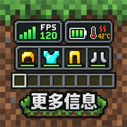
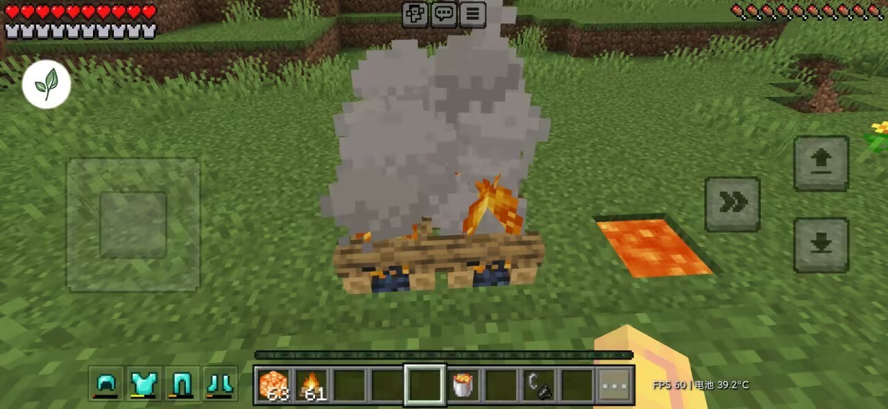
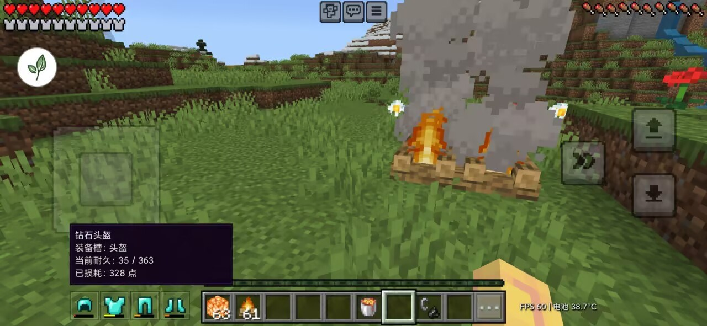
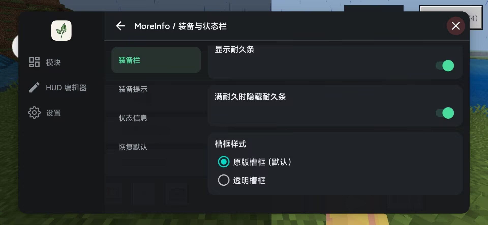
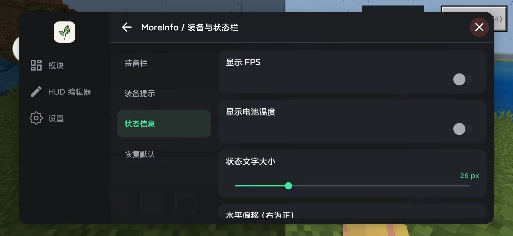

  

<h1 align="center">MoreInfo</h1>

把常用装备与设备状态放到快捷栏旁，查看信息不再来回打开背包。

<strong>简体中文</strong> · <a href="README.en.md">English</a>

MoreInfo 是为 Android 版 LeviLauncher 制作的游戏内信息显示模组。它在快捷栏左侧显示
四个已穿戴盔甲槽和副手槽，在右侧显示 FPS 与电池温度，并提供可即时生效的游戏内设置。
选中潜影盒时，还能直接查看盒内物品和数量。

## 功能

- 在快捷栏旁显示头盔、胸甲、护腿和靴子
- 显示副手物品，并可双击副手槽与当前选中的快捷栏物品交换
- 当前快捷栏槽为空时，可双击副手槽把副手物品卸到该槽
- 使用游戏中的物品图标，并保留附魔光效
- 显示盔甲与副手物品的耐久条，满耐久时默认隐藏
- 长按盔甲或副手槽查看物品名称和精确耐久（当前 / 上限）
- 显示 FPS 与电池温度
- 在快捷栏、背包和容器中预览选中潜影盒的 27 格内容与物品数量
- 潜影盒预览面板随盒子颜色变化，并支持背包和容器内鼠标悬停预览
- 自由调整位置、缩放和文字大小
- 可切换原版槽框或透明槽框
- 可在游戏内切换简体中文与英文，默认使用简体中文
- 设置即时保存，无需每次重启游戏

副手交换只在短时间内连续点击两次副手槽时触发，并使用游戏原版网络库存请求。无法放入副手的物品不会被交换；
长按、拖动或多指操作也不会触发交换。

副手装入、替换、空手卸下以及世界与服务器之间的连续切换已在支持版本上完成测试。服务器仍可能按自身规则限制物品操作；请求被拒绝或超时后，MoreInfo 不会自动重试。

## 潜影盒预览

- 在快捷栏、背包和容器中查看 27 格内容与物品数量，可调整大小与位置。
- 快捷栏与背包、容器的预览可分别开关，预览启用时隐藏对应的原版文字说明。
- 可选“点击外部关闭预览”（默认关闭）：背包、容器里的第一次外部点击只关闭面板，保留物品选中状态；下一次点击正常操作。
- “物品栏预览显示时长”以秒为单位，默认 `0` 表示持续显示；只对快捷栏选中预览计时，背包和容器内的预览不受影响。
- 支持使用 `§` 代码的彩色潜影盒名称。
- 空潜影盒正常显示空格子。
- 预览面板随潜影盒颜色变化，支持未染色和全部 16 种染色；改名后也保留对应配色，物品图标保持原色。

预览内容以客户端实际收到的数据为准；服务器未发送的内容无法预览。

鼠标可悬停背包主区域、背包底部快捷栏或容器中的潜影盒查看预览，移开后隐藏，且不受“物品栏预览显示时长”限制。OTG 鼠标悬停预览已由玩家实测通过。

## 效果预览

### 快捷栏装备与状态信息

### 长按查看装备信息与精确耐久

### 装备栏设置

### 状态信息设置

## 支持版本

- Minecraft 1.26.44.3
- Minecraft 1.26.45.1
- Minecraft 1.26.50.4
- Minecraft 1.26.52.3
- Minecraft 1.26.60.4
- Android ARM64

MoreInfo **1.0.5** 支持以上五个 Minecraft 版本，提供随盒色潜影盒预览、鼠标悬停预览与可选 Debug 日志。

请为实际使用的 Minecraft 版本安装对应支持版本。未列出的版本不会强行加载，以避免崩溃。

## 安装

1. 在 [Releases](https://github.com/188zhuyaqi/MoreInfo/releases) 下载最新的 `.levipack`。
2. 使用 LeviLauncher 导入安装包，并在目标实例中启用 MoreInfo。
3. 完全退出后重新启动游戏。
4. 进入世界后，可从模组菜单打开 **MoreInfo** 调整显示与界面语言。

如果启动器提示版本不兼容，请确认 Minecraft 的完整版本号在上方支持列表中，并删除旧版
MoreInfo 后重新安装当前版本。

## 说明

- 在 LL 模组菜单 → **MoreInfo → Debug** 中，可开启诊断日志并查看实际保存目录。默认关闭；开启后会在本机记录玩家名称、XUID、设备及模组诊断信息，复现问题后可关闭并按需提供日志。日志不会自动上传。
- 温度数据为设备的**电池温度**，不是 CPU 或 GPU 温度。
- 不同设备的系统状态数据可能存在短暂延迟或不可用情况。
- 遇到问题时，请在 [Issues](https://github.com/188zhuyaqi/MoreInfo/issues) 提供 Minecraft、
  LeviLauncher 与 MoreInfo 的完整版本号，并附上截图或相关日志。

作者：**zhuyaqi**
